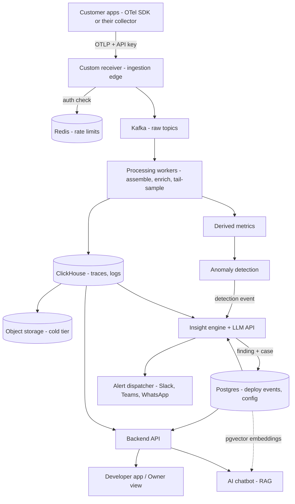
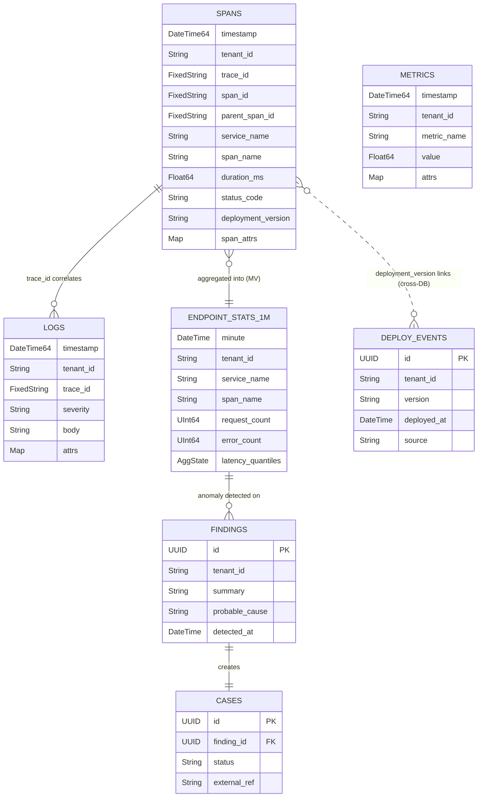

# System Architecture

> **Owner:** Raj
> **Status:** Design discussion. No code yet.
> **Companion docs:** `../product/vision-and-scope.md` (scope) · `../product/requirements.md` (features) · `../delivery/phase-1-plan.md` (build plan)
> **Last updated:** 2026-08-15

---

## 1. Chosen Stack

| Service | Role in our platform | Notes |
|---|---|---|
| **Custom receiver (our ingestion edge — DECIDED)** | Front door: OTLP/HTTP endpoint (gRPC later) — auth, rate limit, tenant tag, normalize → Kafka | Runs in OUR environment (Docker, behind LB, stateless → easy to scale). Python v1 OK; official protobuf libs for parsing. Same endpoint serves SDK-direct customers AND customers' own collectors. Will also host RUM/replay/webhook routes later. |
| **Kafka** | Buffer queue between ingestion and processing | Topics: `spans-raw`, `logs-raw`, `metrics-raw`. Absorbs spikes; decouples stages; replayable. |
| **ClickHouse** | Telemetry store (traces, logs, derived metrics) | Columnar, ~10x compression, fast scans. The "big data" side. Hot window ~15–30 days. |
| **Postgres** | Internal / control-plane DB | Users, accounts, projects, API keys, alert rules, connector configs, cases, findings. Business data = relational + transactional. |
| **pgvector** | RAG vector store (inside Postgres) | Embeddings of past findings, resolved cases, runbooks. One less system to operate. |
| **Redis** | Utility layer | Rate-limit counters (gateway), hot query cache, pub/sub for live UI updates (e.g. "first span arrived"). |

## 2. Additional Components We Must Build/Add

| Component | What it does | Build or use |
|---|---|---|
| **Processing workers** | Consume Kafka: trace assembly (join spans by trace ID), enrichment (deploy tag, geo), tail sampling, write to ClickHouse, compute derived metrics | **We write this** (likely Go; core engineering) |
| **Backend API service** | Serves the frontend: query ClickHouse (traces/logs), Postgres (cases/config), auth & sessions | We write this |
| **Frontend — developer app** | Technical view: findings feed, traces, cases | We write this |
| **Frontend — owner status view** | Plain-language health view | We write this |
| **Anomaly detection service** | Watches derived metrics vs learned baselines; emits detection events | We write; start with statistical rules inside a worker |
| **Insight engine** | On detection: correlate traces + logs + deploy events → probable cause → plain-language finding | We write; calls external **LLM API** |
| **Alert dispatcher** | Delivers findings/cases to Slack, Teams, WhatsApp, email, webhooks | We write; thin per-connector adapters |
| **Object storage (S3-compatible)** | Cold telemetry beyond ClickHouse hot window | Managed service; ClickHouse can tier natively |
| **LLM API (external)** | Summaries, probable-cause text, chatbot answers | External dependency; cost per finding = open question |

## 2b. Ingestion Entrances — one per data door, all converge on Kafka

**Principle: many doors, one hallway.** The OTel collector edge serves door 1 only. Every other door has its own small entrance, but ALL of them publish into the same Kafka → workers → ClickHouse pipeline.

| Door | Entrance | Notes |
|---|---|---|
| 1. OTel (OTLP) | OTel collector edge (Docker, our env) + auth | Kafka exporter; the main door by volume |
| 2. Our probes | None needed — internal | Celery workers (scheduled by Celery Beat, schedules in Postgres) run checks: uptime/latency breakdown, SSL expiry, API checks, Playwright browser flows → normalize → Kafka (`synthetic-results`). Browser checks on their own queue. Start single-region; add regions when needed. |
| 3. Browser snippet | Mostly reuses door 1 — OTel browser SDK speaks OTLP/HTTP to the same collector edge | Needs CORS config + public (non-secret) per-site key. Session replay is the exception: DOM events aren't OTLP → small dedicated HTTP endpoint → Kafka |
| 4a. Webhooks (they call us) | Lightweight HTTP endpoint (part of backend API) | GitHub/CI deploy events → Postgres + Kafka |
| 4b. Pollers (we call them) | Celery worker tasks on schedule | Fetch cloud metrics (CloudWatch/GCP — batch requests, respect API costs & rate limits), DB health (read-only connection, pg_stat_statements). Customer credentials encrypted in Postgres; prefer cross-account IAM role for AWS. Normalize → Kafka. |

**Design rule — normalize early:** every entrance converts its data into our common internal format (OTLP-shaped, since door 1 dominates) BEFORE publishing to Kafka. Downstream components (workers, storage, insight engine) only ever see one format. This prevents per-source if-statements from rotting the whole platform.

## 3. Core Architectural Principle: Data Plane vs Control Plane

**Data plane** (high volume, built for throughput):
Customer OTel SDK/collector → [auth] → our OTel collector → Kafka → processing workers → ClickHouse (+ S3 cold tier)

**Control plane** (low volume, built for correctness):
Frontend ↔ Backend API ↔ Postgres (+pgvector) & Redis

**They touch in exactly two places:**
1. Gateway validates API keys (control plane read) before admitting telemetry.
2. Insight engine writes findings/cases (control plane write) after analyzing telemetry.

Keep this boundary sharp → each side scales independently.

## 4. End-to-End Data Flow



## 5. What Lives Where (quick reference)

| Data | Store |
|---|---|
| Raw spans in flight | Kafka |
| Traces, logs (hot, 15–30 days) | ClickHouse |
| Traces, logs (cold) | Object storage |
| Derived metrics (rate, error %, p95) | ClickHouse (small tables) |
| Users, projects, API keys | Postgres |
| Alert rules, connector configs | Postgres |
| Cases, findings, deploy events | Postgres |
| RAG embeddings (findings, runbooks, resolved cases) | Postgres + pgvector |
| Rate-limit counters, hot cache, live-update pub/sub | Redis |

---

## 5c. Data Layer Design (detailed)

### Principle 1 — Everything becomes one of three shapes

At normalization (receiver / Celery workers), every door's data is forced into the OTel-style signal families before entering Kafka. Storage never knows doors exist.

| Source | Normalized into |
|---|---|
| OTel SDK / collector (door 1) | Spans, logs, metric points (native) |
| Synthetic check result (door 2) | Metrics (`synthetic.check.duration`, `synthetic.check.status` + attrs: check_id, region, step) + log-style record for failure detail (error msg, screenshot ref) |
| CloudWatch / cloud APIs (door 4b) | Metrics (near 1:1 mapping) |
| DB poller stats (door 4b) | Metrics (`db.query.mean_time` + attr query_hash) + periodic log records with query text |
| RUM browser SDK (door 3) | Spans/metrics (native OTel) |
| Deploy webhook (door 4a) | **Event → Postgres, not ClickHouse** (low volume; joined with cases/findings) |
| Session replay (door 3, later) | Exception: DOM event blobs → object storage, indexed by session_id |

### Principle 2 — No JSON dumps. Hybrid schema: promoted columns + attributes map

ClickHouse is columnar — queries read only the columns they touch. JSON blobs destroy this. Pattern (SigNoz-style):
- **Promoted columns**: typed columns for fields every query touches (fast filter/aggregate).
- **Attributes map**: `Map(String, String)` for everything else — customers can send any attribute with no schema change; queryable, just slower.
- **Promotion rule**: if an attribute becomes hot in queries, promote it to a real column.

### Principle 3 — Design backwards from the screens

Storage decisions come from the UI + insight engine's questions, not from the incoming data:
- "Slowest endpoints for service X, last hour" → promoted: service_name, span_name, duration, timestamp
- "Open this full trace" → promoted: trace_id (+ skipping index)
- "Error rate over time per endpoint" → **materialized view** pre-aggregating per minute (dashboards read tiny tables, never scan raw spans)
- "Cart size when it failed?" → rare/investigative → attributes map is fine

### Principle 4 — Three filtering gates

1. **Receiver gate**: reject invalid payloads, bad API keys, over-limit — before any cost.
2. **Processing gate (tail sampling)**: keep 100% of error/slow traces; keep ~1–10% sample of healthy ones. **Derive metrics from ALL traces BEFORE sampling** → numbers stay exact, detail is sampled.
3. **Retention gate (TTL)**: raw spans/logs hot ~15–30 days in ClickHouse → object storage/expire. 1-minute aggregates are tiny → keep 13 months for trends.

### ClickHouse Schema (v1 design)

**Table: spans**
```sql
CREATE TABLE spans (
    timestamp        DateTime64(9),
    tenant_id        LowCardinality(String),
    project_id       LowCardinality(String),
    trace_id         FixedString(32),
    span_id          FixedString(16),
    parent_span_id   FixedString(16),
    service_name     LowCardinality(String),
    span_name        LowCardinality(String),
    span_kind        LowCardinality(String),      -- SERVER/CLIENT/INTERNAL...
    duration_ms      Float64,
    status_code      LowCardinality(String),      -- OK / ERROR / UNSET
    status_message   String,
    http_method      LowCardinality(String),
    http_route       LowCardinality(String),
    http_status      UInt16,
    deployment_version LowCardinality(String),    -- enrichment join key
    resource_attrs   Map(LowCardinality(String), String),
    span_attrs       Map(LowCardinality(String), String),
    events           String,                      -- span events as JSON (exceptions live here)
    INDEX idx_trace_id trace_id TYPE bloom_filter GRANULARITY 4
) ENGINE = MergeTree
PARTITION BY toDate(timestamp)
ORDER BY (tenant_id, service_name, toStartOfHour(timestamp), trace_id)
TTL toDateTime(timestamp) + INTERVAL 30 DAY;
```

**Table: logs**
```sql
CREATE TABLE logs (
    timestamp     DateTime64(9),
    tenant_id     LowCardinality(String),
    project_id    LowCardinality(String),
    trace_id      FixedString(32),               -- correlation to spans ('' if none)
    span_id       FixedString(16),
    service_name  LowCardinality(String),
    severity      LowCardinality(String),        -- DEBUG/INFO/WARN/ERROR/FATAL
    body          String,
    attrs         Map(LowCardinality(String), String),
    INDEX idx_body body TYPE tokenbf_v1(32768, 3, 0) GRANULARITY 4,  -- text search
    INDEX idx_log_trace trace_id TYPE bloom_filter GRANULARITY 4
) ENGINE = MergeTree
PARTITION BY toDate(timestamp)
ORDER BY (tenant_id, service_name, timestamp)
TTL toDateTime(timestamp) + INTERVAL 30 DAY;
```

**Table: metrics (gauges/sums, incl. synthetic + poller data)**
```sql
CREATE TABLE metrics (
    timestamp    DateTime64(3),
    tenant_id    LowCardinality(String),
    project_id   LowCardinality(String),
    metric_name  LowCardinality(String),   -- e.g. synthetic.check.duration, aws.rds.connections
    value        Float64,
    service_name LowCardinality(String),
    attrs        Map(LowCardinality(String), String)  -- region, check_id, query_hash...
) ENGINE = MergeTree
PARTITION BY toDate(timestamp)
ORDER BY (tenant_id, metric_name, timestamp)
TTL toDateTime(timestamp) + INTERVAL 90 DAY;
```

**Materialized view: endpoint stats per minute (feeds dashboards + anomaly detection)**
```sql
CREATE MATERIALIZED VIEW endpoint_stats_1m
ENGINE = AggregatingMergeTree
PARTITION BY toDate(minute)
ORDER BY (tenant_id, service_name, span_name, minute)
TTL minute + INTERVAL 13 MONTH
AS SELECT
    tenant_id,
    service_name,
    span_name,
    toStartOfMinute(timestamp)                    AS minute,
    count()                                       AS request_count,
    countIf(status_code = 'ERROR')                AS error_count,
    quantilesState(0.5, 0.95, 0.99)(duration_ms)  AS latency_quantiles
FROM spans
GROUP BY tenant_id, service_name, span_name, minute;
```
> Note: MV populates from stored (post-sampling) spans. Exact counters derived pre-sampling are ALSO emitted by processing workers into `metrics` — so sampled storage never skews the numbers the anomaly detectors watch.

**Schema design rationale:**
- `tenant_id` FIRST in every ORDER BY → multi-tenant isolation + every query prunes to one tenant's data blocks.
- `LowCardinality(String)` on repeating values (service names, routes) → major compression + speed.
- Bloom-filter index on `trace_id` → fast single-trace lookup despite ORDER BY favoring service/time queries.
- `tokenbf_v1` index on log body → log text search without full scans.
- Daily partitions → TTL drops whole partitions cheaply; time-range queries prune partitions.
- Metrics kept 90d raw / aggregates 13 months → trends + year-over-year while raw detail expires.

### ERD (ClickHouse + control-plane relations)


> DEPLOY_EVENTS, FINDINGS, CASES live in **Postgres** (control plane); SPANS/LOGS/METRICS/MV in **ClickHouse**. The dotted link is a logical join done by the insight engine, not a DB foreign key.

### Query path (UI → data)
UI request → Backend API → translates to SQL: dashboards/trends hit `endpoint_stats_1m` + `metrics` (tiny, fast); investigations hit `spans`/`logs` filtered by tenant + time + trace_id. UI never touches Kafka or raw pipeline.


---

## 5d. Feature-Driven Architecture Additions (from market feature analysis)

Audit result: core architecture (doors → receiver/Celery → Kafka → Go workers → ClickHouse/Postgres) holds for the FULL feature list. Nine additions needed:

| # | Feature driving it | Architecture addition |
|---|---|---|
| 1 | **Service map / dependency graph** (table stakes) | New derived aggregation in Go workers: service dependency edges (caller, callee, call rate, error rate, latency) from parent-child spans crossing service boundaries → small ClickHouse table. No new data collection — derived from traces we have. |
| 2 | **SLO / SLI tracking** (table stakes) | SLO definitions in Postgres (target, window, filter) + computation job reading existing `endpoint_stats_1m` aggregates → error budget status. Math on data we already store. |
| 3 | **Live tail (logs)** | Real-time path: backend WebSocket subscribing to Kafka logs topic (or Redis pub/sub fed by workers), tenant-filtered. ClickHouse can't serve this (batch inserts). |
| 4 | **Usage metering** (powers in-product pricing predictability) | Per-tenant ingestion counters in receiver (extends existing Redis rate-limit counters) → rolled up to usage table → shown in UI as projected/predictable cost. |
| 5 | **PII masking / data scrubbing** | Masking step in processing workers (rules for emails, cards, tokens); user-configurable rules stored in Postgres. Required for session replay; trust feature for logs. |
| 6 | **Log pattern grouping** | Clustering step in processing (Drain-style log templating) → pattern_id attached to logs → UI groups similar lines. |
| 7 | **Continuous profiling as real signal** | OTLP-profiles support in receiver (door 1) + dedicated ClickHouse table for flame-graph data. |
| 8 | **Optional dashboard mode + NL querying + BubbleUp-style analysis** | One flexible ad-hoc query layer in backend API over ClickHouse serves all three: user dashboards, chatbot tool-calling, and attribute-outlier analysis. Design it once. |
| 9 | **RBAC + per-tenant retention controls** | Roles/permissions tables in Postgres (control plane). Per-tenant retention: ClickHouse TTL is table-level → needs scheduled deletes or TTL expressions per plan (open refinement). |

Zero-impact notes: LLM-app observability = traces with `gen_ai.*` attributes (already flows through pipeline; UI lens + maybe promoted columns). Deployment regression detection = deploy events + endpoint stats we already have.

---

## 6. Decisions Log

| Date | Decision |
|---|---|
| 2026-08 | **✅ DECIDED: Ingestion edge = Option B — our own custom receiver.** OTLP/HTTP endpoint first (standard paths /v1/traces, /v1/metrics, /v1/logs; protobuf parsed via official opentelemetry-proto libs), OTLP/gRPC added later. Python acceptable for v1 (stateless — can rewrite in Go if it becomes the bottleneck; invisible to customers). Same endpoint serves SDK-direct customers (Pattern A) AND customers' own collectors (Pattern B, via their otlphttp exporter config). Receiver does auth (API key), rate limiting, tenant tagging, normalization → publishes to Kafka. Will also host other receiving doors' routes (RUM, replay, webhooks) later. **Kafka is internal-only, always** — customers never touch it; receiver is the security & tenancy boundary. Trade-off accepted: we own the receiver code (protocol updates, performance) instead of the collector community. |
| 2026-08 | Kafka as buffer between ingestion and processing |
| 2026-08 | ClickHouse for telemetry; Postgres for control plane; strict data/control plane split |
| 2026-08 | pgvector for RAG (inside Postgres — one less system) |
| 2026-08 | Redis for rate limits, caching, live updates |
| 2026-08 | Object storage tier for cold telemetry |
| 2026-08 | **✅ DECIDED: Doors 2 & 4b (probes + pollers) run on Celery.** Celery Beat as scheduler with database-backed schedules in Postgres (customer edits check config in UI → no redeploys); Redis (already in stack) as broker; Celery workers execute probe/poll tasks, normalize, and publish results to Kafka themselves (no Celery result backend for data). Separate queues: heavy browser checks (Playwright — low concurrency, bigger containers) isolated from lightweight HTTP checks/polls (high concurrency). Start with single-region probes; when multi-region added, enable "must fail in 2+ regions, 2+ consecutive times" alert rule). Every task gets hard timeouts + retry policy respecting cloud API rate limits. Rationale: all-Python consistency, reuses Redis, battle-tested; alternatives (cron, APScheduler, Temporal, K8s CronJobs) either too primitive or too heavy. Swappable later since tasks only publish to Kafka. |
| 2026-08 | **✅ DECIDED: Production language split — Go on the data plane, Python on the control plane.** **Receiver (Go):** net/http (or chi) + google.golang.org/grpc → OTLP/HTTP (4318) AND OTLP/gRPC (4317) from day one; official OTel protobuf/pdata for parsing; franz-go or confluent-kafka-go producer. **Processing workers (Go):** franz-go consumers; small single-purpose services (trace-assembler, log-writer, metrics-deriver) each independently scalable; in-memory trace buffers with timeout eviction; clickhouse-go (native protocol) batched inserts. **Python side:** Backend API = FastAPI (control plane + AI features); Celery probes/pollers (already decided); insight engine = Python (correlation + LLM + stats/ML). Boundary: Go writes Kafka/ClickHouse, Python reads ClickHouse/Postgres — languages never entangle. Rationale: 5–10x throughput + low memory on the hot path; Python's AI ecosystem where intelligence lives. Cost accepted: Go skill required for data plane. |
| 2026-08 | **✅ DECIDED: Trace assembly = in-worker memory + Kafka partitioning by trace_id.** Partitioning guarantees all spans of a trace land on the same worker → plain in-memory dict, no shared state. ~30s wait window; latecomer spans written individually, joined at query time. |
| 2026-08 | **✅ DECIDED: Tail sampling defaults.** Keep 100% of error traces, 100% of slow traces (fixed threshold first, per-endpoint baseline later), 10% of healthy traces; tunable per tenant. Metrics always derived from ALL traces before sampling. |
| 2026-08 | **✅ DECIDED: Error fields promoted.** exception_type + exception_message as real columns (or dedicated errors materialized view) — error grouping is a headline feature. Span events stay as JSON string in v1. |
| 2026-08 | **✅ DECIDED: Multi-tenancy = shared tables + tenant_id first in ORDER BY**, backend API always injects tenant filter. Database-per-tenant only if a giant customer ever demands it. |
| 2026-08 | **✅ DECIDED: Anomaly detection v1 = statistical, not ML.** Per metric: seasonality-aware rolling baseline (compare same hour-of-day/day-of-week), median+MAD or EWMA; flag on sustained deviation (3+ consecutive minutes). Plus absolute rules (error rate > X%, synthetic failing 2+ consecutive runs). ML later, driven by observed gaps. |
| 2026-08 | **✅ DECIDED: LLM strategy = provider-flexible behind our own internal interface.** Chosen providers: OpenAI (hosted) + Ollama (self-hosted/local models) + fine-tuned models (later, e.g. finding summarization trained on resolved findings). Internal abstraction lets us route per task (cheap/local for routine summaries, stronger for RAG chatbot & complex root-cause) and swap freely. |
| 2026-08 | **✅ DECIDED: Deployment = all services as containers, on-premise docker-compose for now.** Everything (receiver, workers, API, Celery, Kafka, ClickHouse, Postgres, Redis, Ollama) defined in compose on our own hardware. Accepted trade-off: we own ops (backups, upgrades, disk sizing for Kafka/ClickHouse). Container-first design keeps later migration to orchestrated/multi-host or managed services straightforward. |
| 2026-08 | **✅ DECIDED: Ingestion protection** — receiver does per-key validation + rate limiting via Redis counters (part of receiver decision; confirmed). |
| 2026-08 | **✅ DECIDED: Full-feature audit passed — core architecture unchanged; 9 additions adopted (see §5d):** service-map edge aggregation, SLO computation on existing aggregates, live-tail real-time path (WebSocket ← Kafka/Redis pub/sub), usage metering (extends rate-limit counters), PII masking step in workers, log pattern grouping (Drain-style), OTLP-profiles + profiles table, one flexible ad-hoc query layer (dashboards + chatbot tools + outlier analysis), RBAC tables. |
| 2026-08 | **✅ DECIDED: Data layer design (see §5c).** All doors normalize to 3 shapes (spans/logs/metrics); deploy events → Postgres; replay blobs → object storage. ClickHouse hybrid schema: promoted columns + attributes Map (no JSON dumps). tenant_id first in every ORDER BY (multi-tenancy). Materialized views for per-minute endpoint stats (dashboards + anomaly feed). Three gates: receiver rejects garbage, tail sampling keeps 100% error/slow + 1–10% healthy (metrics derived BEFORE sampling), TTL 30d raw / 90d metrics / 13mo aggregates. Design driven backwards from UI + insight questions. |
| 2026-08-25 | **✅ DECIDED: Phase 1 sequencing = walking skeleton, then widen.** One thin end-to-end path (demo app → receiver → broker → worker → ClickHouse → API → UI, running in compose) before any door is built out. Rationale: four parallel ingestion projects integrate only at the end; a running spine de-risks every later door. See `../delivery/phase-1-plan.md`. |
| 2026-08-25 | ~~**DECIDED: Redpanda replaces Kafka as the buffer**~~ **SUPERSEDED same day — see the reversal entry below.** (for on-prem single-host compose). Kafka API-compatible — `franz-go` producer/consumer code is unchanged — but single binary, no JVM, no KRaft/ZK tuning, far lower memory. Moving to real Kafka later is a config change, not a rewrite. Topic names and partitioning strategy (by trace_id) unchanged. |
| 2026-08-25 | **✅ DECIDED: Go on the data plane from day one** — no interim Python receiver. Confirms the earlier language-split decision; avoids writing the hot path twice and porting exactly when volume makes it urgent. |
| 2026-08-25 | **✅ DECIDED: Monorepo, polyglot.** `apps/` (receiver, workers, api, scheduler, web) · `packages/` (contracts, ui, client-ts) · `deploy/` · `tools/` · `docs/`. Go workspaces + uv workspace + pnpm workspace, one `just` task runner with identical verbs per service. Inside services: domain-oriented folders (`ingest/ traces/ logs/ metrics/ tenancy/`), never layer-oriented. |
| 2026-08-25 | **✅ DECIDED: Frontend = Vite + React + TanStack Router/Query; uPlot for time series.** No Next.js — the app is entirely behind auth, so RSC complexity buys nothing. uPlot because dense telemetry charts need 100k-point rendering that card-oriented chart libraries cannot do. Auth: FastAPI sessions + argon2, self-hosted, no Keycloak/Ory. |
| 2026-08-25 | **✅ DECIDED: The internal normalized envelope is a frozen contract** (`packages/contracts`) with golden fixtures per door, designed before the first door is built. Every door writes it; every worker reads it; changing it later touches everything. |
| 2026-08-25 | **✅ DECIDED: Phase 1 signal/category/door coverage.** All four doors open in Phase 1. Signals: traces, logs, app + infra metrics, deploy events, synthetic results — profiles and session replay deferred to Phase 2. Categories covered: synthetic, error tracking, APM, logs, RUM, infrastructure, database, **plus service map** (F9 — derived edge aggregation over spans, no new collection). Kubernetes telemetry is ingested via door 1 and queryable, but pod/node/namespace screens are Phase 2. UI is fixed screens per signal — no dashboard builder (F20 stays Phase 2). Object-storage cold tier is built in Phase 1 (MinIO + ClickHouse-native S3 tiering) rather than letting the 30-day TTL delete raw data. Source-map symbolication added to door 3, without which RUM errors are unusable. Network monitoring (eBPF) and SIEM remain unplaced — open. |
| 2026-08-25 | **✅ DECIDED (supersedes the Redpanda entry): buffer = Apache Kafka 4.x in KRaft mode.** Two independent reasons found in research. **Licence:** Redpanda Community Edition is BSL 1.1; its Streaming/Queueing Service clause forbids commercial offerings that let third parties directly or indirectly cause topic creation — an unresolved ambiguity for a commercial SaaS, and it would rule out per-tenant topics permanently. Kafka is Apache 2.0 with no such question. **Performance:** the "lighter, no JVM" rationale was ZooKeeper-era. Kafka 4.0 removed ZooKeeper entirely; an April 2026 benchmark on identical hardware measured Kafka 4.2 KRaft at higher sustained throughput using 3× less memory than Redpanda, winning every acks=all test. Cost accepted: JVM tuning is ours to own. `franz-go` producer/consumer code is identical either way. |
| 2026-08-25 | **✅ DECIDED: ClickHouse write path uses `ch-go`, not `clickhouse-go/v2`.** ClickHouse's own client documentation recommends the low-level `ch-go` for insert-heavy workloads; `clickhouse-go` adds a row→column pivot plus reflection on every insert. Our workers do nothing but batched inserts. (`clickhouse-go` v2.3+ wraps `ch-go` internally — this is a choice of layer, not of project.) Python read path continues to use `clickhouse-connect`. |
| 2026-08-25 | **✅ DECIDED: frontend router = TanStack Router.** In an observability UI the URL carries time ranges, filters, service names and trace IDs; TanStack Router types search params end-to-end, and pairs natively with TanStack Query. React Router v8 has the larger ecosystem but weaker search-param inference and a yearly major cadence with a migration history. |
| 2026-08-25 | **✅ CONFIRMED by research: franz-go, uv, uPlot, Biome, Celery.** franz-go is feature-complete through Kafka 4.2+ and pure Go (confluent-kafka-go's librdkafka cgo dependency complicates static builds). uv has overtaken Poetry in downloads and has Astral/OpenAI backing. uPlot remains the time-series specialist; ECharts degrades past ~500K–1M points — but note the service map needs a **graph** library, still unpicked. Biome 2.2's `noRestrictedImports` patterns plus `noImportCycle` cover our import-boundary rules, so no second linter (dependency-cruiser stays the fallback). Celery kept despite async-native queues (Taskiq/FastStream/Dramatiq) outperforming it on I/O-bound work — our probe volume is per-minute, not per-second, and Playwright checks suit a process-based model. |
| 2026-08-25 | **✅ DECIDED: internal envelope = thin protobuf wrapper around OTLP.** `packages/contracts` defines one message carrying our metadata as typed fields — tenant_id, project_id, door, received_at — around an untouched OTLP payload. We do **not** define our own span/log/metric schema: OTel already did, it is what customer SDKs emit, and reusing it means door 1 (99% of volume) validates and forwards the same bytes instead of re-modelling and re-encoding them. Other doors build OTLP-shaped payloads with official libraries, so downstream still sees exactly one format. Codegen and compatibility checking via `buf` (`buf breaking` in CI). Rationale over JSON: the envelope is written by two languages and read by four workers at thousands of messages/sec — a renamed field must fail CI, not silently write zeros for three weeks. tenant_id is a typed field rather than a map key because the multi-tenancy invariant rests on it. |
| 2026-08-25 | **✅ DECIDED: service-map rendering = React Flow (xyflow), MIT.** Nodes are React components, so each service box carries name, health colour, request/error rate and a sparkline; pan/zoom/drag come free; layout via dagre or elkjs. Cytoscape.js is the stronger engine for thousands of nodes with WebGL rendering, but our target customers (2–15 person startups) have 5–50 services, and Cytoscape's non-React rendering world makes rich node content harder. Revisit only if graph size ever contradicts that assumption. |
| 2026-08-25 | **✅ DECIDED: UI stack = Tailwind v4 + Base UI, scaffolded with shadcn/ui.** shadcn is a code *distribution registry* built on Base UI, not a competing library — the CLI copies source into our repo which we then own and restyle, and it has defaulted to Base UI since December 2025. Base UI over Radix because the original Radix engineers now build it at MUI with a full-time team and monthly releases, while Radix maintenance has visibly slowed. The risk shadcn carries is its default look — the recognizable AI-generated signature — handled by a lint gate: default Tailwind palette names fail CI anywhere in the repo, so only our tokens exist. Waterfall, log viewer, service map and sparkline are built from scratch regardless. |
| 2026-08-25 | **✅ DECIDED: colour system — OKLCH, dark-first, and health is the absence of colour.** OKLCH for perceptual uniformity; separate light and dark palettes; twelve steps each with a defined job; APCA Lc ≥ 60 for body text. The governing rule: status hues are reserved and excluded from the categorical series palette, because if a chart series can be red then red stops meaning "bad". Severity is critical=red, warning=amber, info=blue, **healthy=neutral with no hue** — colour means something needs you, and a wall of green dots contradicts a product whose point is calm. This also sidesteps the red/green deuteranopia collision without abandoning red, which is too deeply learned to fight. Colour is never the sole carrier: every severity also has shape, weight and position. Full system in `docs/design/design-system.md`. |

## 7. Open Questions (discuss next)

*(Most questions resolved — see Decisions Log. Remaining refinements:)*

- Per-tenant retention controls: ClickHouse TTL is table-level — scheduled deletes vs TTL expressions per plan tier?
- Tail sampling: slow-trace threshold — fixed (e.g. >2s) at first; when to move to per-endpoint relative baselines?
- Attribute promotion policy in practice: review query logs periodically; which attributes earn promotion first?
- On-premise docker-compose: single-host resource sizing for Kafka + ClickHouse + all services; backup strategy for ClickHouse & Postgres volumes; when does growth force a move to multi-host/orchestrated setup?
- Fine-tuned model: which task first (finding summarization is the best candidate — narrow, repetitive, high-volume)? Training data comes from resolved findings + edits users make to AI text.

## 8. Parking Lot

- Synthetic probe fleet architecture — needs its own mini-design
- Browser RUM snippet delivery
- Pull-integration workers for cloud APIs / DB stats (door 4)

*(Update this doc as decisions are made.)*
