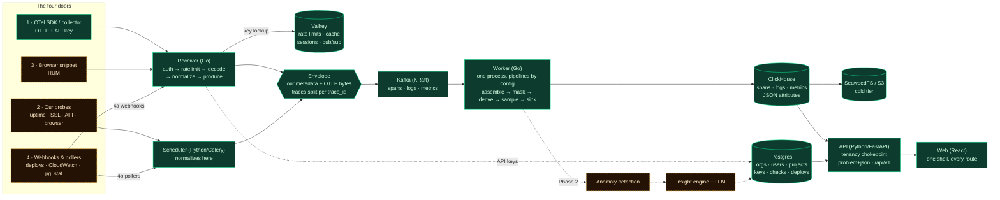
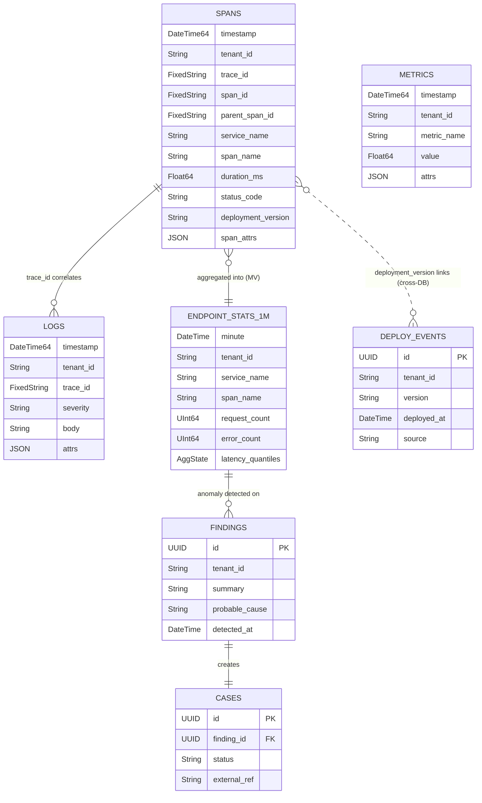

# System Architecture

> **Owner:** Raj
> **Status:** Design discussion. No code yet.
> **Companion docs:** `../product/vision-and-scope.md` (scope) · `../product/requirements.md` (features) · `../delivery/phase-1-plan.md` (build plan)
> **Last updated:** 2026-08-15

---

## 1. Chosen Stack

| Service | Role in our platform | Notes |
|---|---|---|
| **Custom receiver (our ingestion edge — DECIDED)** | Front door: OTLP/HTTP endpoint (gRPC later) — auth, rate limit, tenant tag, normalize → Kafka | Runs in OUR environment (Docker, behind LB, stateless → easy to scale). Python v1 OK; official protobuf libs for parsing. Same endpoint serves SDK-direct customers AND customers' own collectors. Will also host RUM/replay/webhook routes later. |
| **Kafka** | Buffer queue between ingestion and processing | Topics: `spans-raw`, `logs-raw`, `metrics-raw`. Absorbs spikes; decouples stages; replayable. |
| **ClickHouse** | Telemetry store (traces, logs, derived metrics) | Columnar, ~10x compression, fast scans. The "big data" side. Hot window ~15–30 days. |
| **Postgres** | Internal / control-plane DB | Users, accounts, projects, API keys, alert rules, connector configs, cases, findings. Business data = relational + transactional. |
| **pgvector** | RAG vector store (inside Postgres) | Embeddings of past findings, resolved cases, runbooks. One less system to operate. |
| **Valkey** (BSD-3 Redis fork, ADR 0048) | Utility layer | Rate-limit counters (gateway), hot query cache, pub/sub for live UI updates (e.g. "first span arrived"). |

## 2. Additional Components We Must Build/Add

| Component | What it does | Build or use |
|---|---|---|
| **Processing workers** | Consume Kafka: trace assembly (join spans by trace ID), enrichment (deploy tag, geo), tail sampling, write to ClickHouse, compute derived metrics | **We write this** (likely Go; core engineering) |
| **Backend API service** | Serves the frontend: query ClickHouse (traces/logs), Postgres (cases/config), auth & sessions | We write this |
| **Frontend — developer app** | Technical view: findings feed, traces, cases | We write this |
| **Frontend — owner status view** | Plain-language health view | We write this |
| **Anomaly detection service** | Watches derived metrics vs learned baselines; emits detection events | We write; start with statistical rules inside a worker |
| **Insight engine** | On detection: correlate traces + logs + deploy events → probable cause → plain-language finding | We write; calls external **LLM API** |
| **Alert dispatcher** | Delivers findings/cases to Slack, Teams, WhatsApp, email, webhooks | We write; thin per-connector adapters |
| **Object storage (S3-compatible)** | Cold telemetry beyond ClickHouse hot window | Managed service; ClickHouse can tier natively |
| **LLM API (external)** | Summaries, probable-cause text, chatbot answers | External dependency; cost per finding = open question |

## 2b. Ingestion Entrances — one per data door, all converge on Kafka

**Principle: many doors, one hallway.** The OTel collector edge serves door 1 only. Every other door has its own small entrance, but ALL of them publish into the same Kafka → workers → ClickHouse pipeline.

| Door | Entrance | Notes |
|---|---|---|
| 1. OTel (OTLP) | OTel collector edge (Docker, our env) + auth | Kafka exporter; the main door by volume |
| 2. Our probes | None needed — internal | Celery workers (scheduled by Celery Beat, schedules in Postgres) run checks: uptime/latency breakdown, SSL expiry, API checks, Playwright browser flows → normalize → Kafka (`synthetic-results`). Browser checks on their own queue. Start single-region; add regions when needed. |
| 3. Browser snippet | Mostly reuses door 1 — OTel browser SDK speaks OTLP/HTTP to the same collector edge | Needs CORS config + public (non-secret) per-site key. Session replay is the exception: DOM events aren't OTLP → small dedicated HTTP endpoint → Kafka |
| 4a. Webhooks (they call us) | Lightweight HTTP endpoint (part of backend API) | GitHub/CI deploy events → Postgres + Kafka |
| 4b. Pollers (we call them) | Celery worker tasks on schedule | Fetch cloud metrics (CloudWatch/GCP — batch requests, respect API costs & rate limits), DB health (read-only connection, pg_stat_statements). Customer credentials encrypted in Postgres; prefer cross-account IAM role for AWS. Normalize → Kafka. |

**Design rule — normalize early:** every entrance converts its data into our common internal format (OTLP-shaped, since door 1 dominates) BEFORE publishing to Kafka. Downstream components (workers, storage, insight engine) only ever see one format. This prevents per-source if-statements from rotting the whole platform.

## 3. Core Architectural Principle: Data Plane vs Control Plane

**Data plane** (high volume, built for throughput):
Customer OTel SDK/collector → [auth] → our OTel collector → Kafka → processing workers → ClickHouse (+ S3 cold tier)

**Control plane** (low volume, built for correctness):
Frontend ↔ Backend API ↔ Postgres (+pgvector) & Redis

**They touch in exactly two places:**
1. Gateway validates API keys (control plane read) before admitting telemetry.
2. Insight engine writes findings/cases (control plane write) after analyzing telemetry.

Keep this boundary sharp → each side scales independently.

## 4. End-to-End Data Flow



> **Green is running today** (M0): every door-1 path, the envelope, both stores, the API and the web shell all come up healthy under `just dev`. **Amber is designed and not yet built** — doors 2–4 land in M4/M5, and the insight engine is Phase 2.


## 5. What Lives Where (quick reference)

| Data | Store |
|---|---|
| Raw spans in flight | Kafka |
| Traces, logs (hot, 15–30 days) | ClickHouse |
| Traces, logs (cold) | Object storage |
| Derived metrics (rate, error %, p95) | ClickHouse (small tables) |
| Users, projects, API keys | Postgres |
| Alert rules, connector configs | Postgres |
| Cases, findings, deploy events | Postgres |
| RAG embeddings (findings, runbooks, resolved cases) | Postgres + pgvector |
| Rate-limit counters, hot cache, live-update pub/sub | Redis |

---

## 5c. Data Layer Design (detailed)

### Principle 1 — Everything becomes one of three shapes

At normalization (receiver / Celery workers), every door's data is forced into the OTel-style signal families before entering Kafka. Storage never knows doors exist.

| Source | Normalized into |
|---|---|
| OTel SDK / collector (door 1) | Spans, logs, metric points (native) |
| Synthetic check result (door 2) | Metrics (`synthetic.check.duration`, `synthetic.check.status` + attrs: check_id, region, step) + log-style record for failure detail (error msg, screenshot ref) |
| CloudWatch / cloud APIs (door 4b) | Metrics (near 1:1 mapping) |
| DB poller stats (door 4b) | Metrics (`db.query.mean_time` + attr query_hash) + periodic log records with query text |
| RUM browser SDK (door 3) | Spans/metrics (native OTel) |
| Deploy webhook (door 4a) | **Event → Postgres, not ClickHouse** (low volume; joined with cases/findings) |
| Session replay (door 3, later) | Exception: DOM event blobs → object storage, indexed by session_id |

### Principle 2 — Hybrid schema: promoted columns + native JSON attributes

ClickHouse is columnar — queries read only the columns they touch. A JSON *string blob* destroys that, because every query re-parses it. The pattern:
- **Promoted columns**: typed columns for fields every query touches (fast filter/aggregate).
- **Attributes as the native `JSON` type**: customers can send any attribute with no schema change, and ClickHouse stores each path as a real subcolumn — individually indexed, individually compressed, and read without touching the others.
- **Promotion rule**: if an attribute becomes hot in queries, promote it to a real column.

> **Revised 2026-08-25.** This previously specified `Map(LowCardinality(String), String)`. ClickHouse's own observability stack (ClickStack) migrated off Map to the native JSON type and reports ~9× faster queries. The reason is structural: Map keys are not true subcolumns, so reading *any* key loads the entire map into memory, and keys cannot be individually indexed or compressed. The JSON type was built for exactly this workload. Requires a recent ClickHouse version — pin it in compose.

### Principle 3 — Design backwards from the screens

Storage decisions come from the UI + insight engine's questions, not from the incoming data:
- "Slowest endpoints for service X, last hour" → promoted: service_name, span_name, duration, timestamp
- "Open this full trace" → promoted: trace_id (+ skipping index)
- "Error rate over time per endpoint" → **materialized view** pre-aggregating per minute (dashboards read tiny tables, never scan raw spans)
- "Cart size when it failed?" → rare/investigative → attributes map is fine

### Principle 4 — Three filtering gates

1. **Receiver gate**: reject invalid payloads, bad API keys, over-limit — before any cost.
2. **Processing gate (tail sampling)**: keep 100% of error/slow traces; keep ~1–10% sample of healthy ones. **Derive metrics from ALL traces BEFORE sampling** → numbers stay exact, detail is sampled.
3. **Retention gate (TTL)**: raw spans/logs hot ~15–30 days in ClickHouse → object storage/expire. 1-minute aggregates are tiny → keep 13 months for trends.

### ClickHouse Schema (v1 design)

**Table: spans**
```sql
CREATE TABLE spans (
    timestamp        DateTime64(9),
    tenant_id        LowCardinality(String),
    project_id       LowCardinality(String),
    trace_id         FixedString(32),
    span_id          FixedString(16),
    parent_span_id   FixedString(16),
    service_name     LowCardinality(String),
    span_name        LowCardinality(String),
    span_kind        LowCardinality(String),      -- SERVER/CLIENT/INTERNAL...
    duration_ms      Float64,
    status_code      LowCardinality(String),      -- OK / ERROR / UNSET
    status_message   String,
    http_method      LowCardinality(String),
    http_route       LowCardinality(String),
    http_status      UInt16,
    deployment_version LowCardinality(String),    -- enrichment join key
    resource_attrs   JSON,
    span_attrs       JSON,
    events           String,                      -- span events as JSON (exceptions live here)
    INDEX idx_trace_id trace_id TYPE bloom_filter GRANULARITY 4
) ENGINE = MergeTree
PARTITION BY toDate(timestamp)
ORDER BY (tenant_id, project_id, service_name, toStartOfHour(timestamp), trace_id)
TTL toDateTime(timestamp) + INTERVAL 30 DAY;
```

**Table: span_trace_lookup** (+ `span_trace_lookup_mv`) — ADR 0054

Opening one trace by id has no time bound, so a query against `spans` alone leans entirely on the bloom filter and touches every partition in the retention range. This table answers *when did trace X happen?* from its own ordering key, and that answer bounds the query that follows.

```sql
CREATE TABLE span_trace_lookup (
    tenant_id  LowCardinality(String),
    trace_id   FixedString(32),
    span_start DateTime64(9),
    span_end   DateTime64(9)
) ENGINE = MergeTree
ORDER BY (tenant_id, trace_id)
TTL toDateTime(span_end) + INTERVAL 30 DAY;

CREATE MATERIALIZED VIEW span_trace_lookup_mv TO span_trace_lookup
AS SELECT tenant_id, trace_id, min(timestamp) AS span_start, max(timestamp) AS span_end
FROM spans GROUP BY tenant_id, trace_id;
```

**One row per insert block, not per trace.** A trace whose spans arrive in several batches lands several rows, so every reader must aggregate `min(span_start)`, `max(span_end)`. Note also that `ALTER TABLE spans DELETE` does not cascade here — orphan rows claim a trace exists until TTL clears them, so the detail query treats "lookup hit, no spans" as not-found rather than as an error.

**Table: logs**
```sql
CREATE TABLE logs (
    timestamp     DateTime64(9),
    tenant_id     LowCardinality(String),
    project_id    LowCardinality(String),
    trace_id      FixedString(32),               -- correlation to spans ('' if none)
    span_id       FixedString(16),
    service_name  LowCardinality(String),
    severity      LowCardinality(String),        -- DEBUG/INFO/WARN/ERROR/FATAL
    body          String,
    attrs         JSON,
    INDEX idx_body body TYPE tokenbf_v1(32768, 3, 0) GRANULARITY 4,  -- text search
    INDEX idx_log_trace trace_id TYPE bloom_filter GRANULARITY 4
) ENGINE = MergeTree
PARTITION BY toDate(timestamp)
ORDER BY (tenant_id, service_name, timestamp)
TTL toDateTime(timestamp) + INTERVAL 30 DAY;
```

**Table: metrics (gauges/sums, incl. synthetic + poller data)**
```sql
CREATE TABLE metrics (
    timestamp    DateTime64(3),
    tenant_id    LowCardinality(String),
    project_id   LowCardinality(String),
    metric_name  LowCardinality(String),   -- e.g. synthetic.check.duration, aws.rds.connections
    value        Float64,
    service_name LowCardinality(String),
    attrs        JSON                     -- region, check_id, query_hash...
) ENGINE = MergeTree
PARTITION BY toDate(timestamp)
ORDER BY (tenant_id, metric_name, timestamp)
TTL toDateTime(timestamp) + INTERVAL 90 DAY;
```

**Materialized view: endpoint stats per minute (feeds dashboards + anomaly detection)**
```sql
CREATE MATERIALIZED VIEW endpoint_stats_1m
ENGINE = AggregatingMergeTree
PARTITION BY toDate(minute)
ORDER BY (tenant_id, service_name, span_name, minute)
TTL minute + INTERVAL 13 MONTH
AS SELECT
    tenant_id,
    service_name,
    span_name,
    toStartOfMinute(timestamp)                    AS minute,
    count()                                       AS request_count,
    countIf(status_code = 'ERROR')                AS error_count,
    quantilesState(0.5, 0.95, 0.99)(duration_ms)  AS latency_quantiles
FROM spans
GROUP BY tenant_id, service_name, span_name, minute;
```
> ⚠️ **The form above will not aggregate correctly — corrected 2026-08-26 while building P1-10.** An implicit-inner-table materialized view over `AggregatingMergeTree` with `count()` / `countIf()` produces plain `UInt64` columns, and plain columns do not merge: rows accumulate instead of combining. It needs an **explicit target table** (`CREATE MATERIALIZED VIEW … TO …`) whose columns are `SimpleAggregateFunction(sum, UInt64)` for the counters and `AggregateFunction(quantiles(…), Float64)` for the latencies, partitioned **by month** rather than by day since it is a 13-month table. Whoever implements P1-23 should start from that shape.
>
> Note: MV populates from stored (post-sampling) spans. Exact counters derived pre-sampling are ALSO emitted by processing workers into `metrics` — so sampled storage never skews the numbers the anomaly detectors watch.

**Schema design rationale:**
- `tenant_id` FIRST in every ORDER BY → multi-tenant isolation + every query prunes to one tenant's data blocks.
- `project_id` SECOND on `spans` — added 2026-08-26. A project *is* an environment under the tenancy model (written after this schema), so every query filters it. Without it, staging and production rows interleave in the same granules and every production read pulls staging data off disk.
- `LowCardinality(String)` on repeating values (service names, routes) → major compression + speed.
- Attributes as native `JSON` → each attribute path is its own subcolumn, so a query for one attribute never reads the rest.
- Bloom-filter index on `trace_id` → fast single-trace lookup despite ORDER BY favoring service/time queries.
- `tokenbf_v1` index on log body → log text search without full scans.
- Daily partitions → TTL drops whole partitions cheaply; time-range queries prune partitions.
- Metrics kept 90d raw / aggregates 13 months → trends + year-over-year while raw detail expires.

### ERD (ClickHouse + control-plane relations)


> DEPLOY_EVENTS, FINDINGS, CASES live in **Postgres** (control plane); SPANS/LOGS/METRICS/MV in **ClickHouse**. The dotted link is a logical join done by the insight engine, not a DB foreign key.

### Query path (UI → data)
UI request → Backend API → translates to SQL: dashboards/trends hit `endpoint_stats_1m` + `metrics` (tiny, fast); investigations hit `spans`/`logs` filtered by tenant + time + trace_id. UI never touches Kafka or raw pipeline.


---

## 5d. Feature-Driven Architecture Additions (from market feature analysis)

Audit result: core architecture (doors → receiver/Celery → Kafka → Go workers → ClickHouse/Postgres) holds for the FULL feature list. Nine additions needed:

| # | Feature driving it | Architecture addition |
|---|---|---|
| 1 | **Service map / dependency graph** (table stakes) | New derived aggregation in Go workers: service dependency edges (caller, callee, call rate, error rate, latency) from parent-child spans crossing service boundaries → small ClickHouse table. No new data collection — derived from traces we have. |
| 2 | **SLO / SLI tracking** (table stakes) | SLO definitions in Postgres (target, window, filter) + computation job reading existing `endpoint_stats_1m` aggregates → error budget status. Math on data we already store. |
| 3 | **Live tail (logs)** | Real-time path: backend WebSocket subscribing to Kafka logs topic (or Redis pub/sub fed by workers), tenant-filtered. ClickHouse can't serve this (batch inserts). |
| 4a | **API rate limiting** (added 2026-08-26) | Distinct from ingest limiting and often confused with it. Ingest limits are per API key on the data plane, in the receiver. **API limits are per user and per organization on the control plane**, in FastAPI middleware over Valkey: strict on login and signup (keyed per IP *and* per email, since brute force is the actual threat), a low limit plus a concurrency cap on ClickHouse-backed endpoints so one user cannot saturate the database, a default elsewhere. Sliding-window rather than fixed-window — a fixed window lets a caller spend a full allowance either side of a boundary, which is exactly the burst a login limit exists to stop. Limits come from the plan tier in Postgres, never hardcoded. |
| 4 | **Usage metering** (powers in-product pricing predictability) | Per-tenant ingestion counters in receiver (extends existing Redis rate-limit counters) → rolled up to usage table → shown in UI as projected/predictable cost. |
| 5 | **PII masking / data scrubbing** | Masking step in processing workers (rules for emails, cards, tokens); user-configurable rules stored in Postgres. Required for session replay; trust feature for logs. |
| 6 | **Log pattern grouping** | Clustering step in processing (Drain-style log templating) → pattern_id attached to logs → UI groups similar lines. |
| 7 | **Continuous profiling as real signal** | OTLP-profiles support in receiver (door 1) + dedicated ClickHouse table for flame-graph data. |
| 8 | **Optional dashboard mode + NL querying + BubbleUp-style analysis** | One flexible ad-hoc query layer in backend API over ClickHouse serves all three: user dashboards, chatbot tool-calling, and attribute-outlier analysis. Design it once. |
| 9 | **RBAC + per-tenant retention controls** | Roles/permissions tables in Postgres (control plane). Per-tenant retention: ClickHouse TTL is table-level → needs scheduled deletes or TTL expressions per plan (open refinement). |

Zero-impact notes: LLM-app observability = traces with `gen_ai.*` attributes (already flows through pipeline; UI lens + maybe promoted columns). Deployment regression detection = deploy events + endpoint stats we already have.

---

## 6. Decisions Log

> This table is the chronological index. The full record of each decision — context, decision, and the consequences we accepted — lives as one ADR per file in [`decisions/`](decisions/), numbered in the order below. ADRs are never edited once accepted; a changed decision gets a new ADR that supersedes the old one.

| Date | Decision |
|---|---|
| 2026-08 | **✅ DECIDED: Ingestion edge = Option B — our own custom receiver.** OTLP/HTTP endpoint first (standard paths /v1/traces, /v1/metrics, /v1/logs; protobuf parsed via official opentelemetry-proto libs), OTLP/gRPC added later. Python acceptable for v1 (stateless — can rewrite in Go if it becomes the bottleneck; invisible to customers). Same endpoint serves SDK-direct customers (Pattern A) AND customers' own collectors (Pattern B, via their otlphttp exporter config). Receiver does auth (API key), rate limiting, tenant tagging, normalization → publishes to Kafka. Will also host other receiving doors' routes (RUM, replay, webhooks) later. **Kafka is internal-only, always** — customers never touch it; receiver is the security & tenancy boundary. Trade-off accepted: we own the receiver code (protocol updates, performance) instead of the collector community. |
| 2026-08 | Kafka as buffer between ingestion and processing |
| 2026-08 | ClickHouse for telemetry; Postgres for control plane; strict data/control plane split |
| 2026-08 | pgvector for RAG (inside Postgres — one less system) |
| 2026-08 | Redis for rate limits, caching, live updates |
| 2026-08 | Object storage tier for cold telemetry |
| 2026-08 | **✅ DECIDED: Doors 2 & 4b (probes + pollers) run on Celery.** Celery Beat as scheduler with database-backed schedules in Postgres (customer edits check config in UI → no redeploys); Redis (already in stack) as broker; Celery workers execute probe/poll tasks, normalize, and publish results to Kafka themselves (no Celery result backend for data). Separate queues: heavy browser checks (Playwright — low concurrency, bigger containers) isolated from lightweight HTTP checks/polls (high concurrency). Start with single-region probes; when multi-region added, enable "must fail in 2+ regions, 2+ consecutive times" alert rule). Every task gets hard timeouts + retry policy respecting cloud API rate limits. Rationale: all-Python consistency, reuses Redis, battle-tested; alternatives (cron, APScheduler, Temporal, K8s CronJobs) either too primitive or too heavy. Swappable later since tasks only publish to Kafka. |
| 2026-08 | **✅ DECIDED: Production language split — Go on the data plane, Python on the control plane.** **Receiver (Go):** net/http (or chi) + google.golang.org/grpc → OTLP/HTTP (4318) AND OTLP/gRPC (4317) from day one; official OTel protobuf/pdata for parsing; franz-go or confluent-kafka-go producer. **Processing workers (Go):** franz-go consumers; small single-purpose services (trace-assembler, log-writer, metrics-deriver) each independently scalable; in-memory trace buffers with timeout eviction; clickhouse-go (native protocol) batched inserts. **Python side:** Backend API = FastAPI (control plane + AI features); Celery probes/pollers (already decided); insight engine = Python (correlation + LLM + stats/ML). Boundary: Go writes Kafka/ClickHouse, Python reads ClickHouse/Postgres — languages never entangle. Rationale: 5–10x throughput + low memory on the hot path; Python's AI ecosystem where intelligence lives. Cost accepted: Go skill required for data plane. |
| 2026-08 | **✅ DECIDED: Trace assembly = in-worker memory + Kafka partitioning by trace_id.** Partitioning guarantees all spans of a trace land on the same worker → plain in-memory dict, no shared state. ~30s wait window; latecomer spans written individually, joined at query time. |
| 2026-08 | **✅ DECIDED: Tail sampling defaults.** Keep 100% of error traces, 100% of slow traces (fixed threshold first, per-endpoint baseline later), 10% of healthy traces; tunable per tenant. Metrics always derived from ALL traces before sampling. |
| 2026-08 | **✅ DECIDED: Error fields promoted.** exception_type + exception_message as real columns (or dedicated errors materialized view) — error grouping is a headline feature. Span events stay as JSON string in v1. |
| 2026-08 | **✅ DECIDED: Multi-tenancy = shared tables + tenant_id first in ORDER BY**, backend API always injects tenant filter. Database-per-tenant only if a giant customer ever demands it. |
| 2026-08 | **✅ DECIDED: Anomaly detection v1 = statistical, not ML.** Per metric: seasonality-aware rolling baseline (compare same hour-of-day/day-of-week), median+MAD or EWMA; flag on sustained deviation (3+ consecutive minutes). Plus absolute rules (error rate > X%, synthetic failing 2+ consecutive runs). ML later, driven by observed gaps. |
| 2026-08 | **✅ DECIDED: LLM strategy = provider-flexible behind our own internal interface.** Chosen providers: OpenAI (hosted) + Ollama (self-hosted/local models) + fine-tuned models (later, e.g. finding summarization trained on resolved findings). Internal abstraction lets us route per task (cheap/local for routine summaries, stronger for RAG chatbot & complex root-cause) and swap freely. |
| 2026-08 | **✅ DECIDED: Deployment = all services as containers, on-premise docker-compose for now.** Everything (receiver, workers, API, Celery, Kafka, ClickHouse, Postgres, Redis, Ollama) defined in compose on our own hardware. Accepted trade-off: we own ops (backups, upgrades, disk sizing for Kafka/ClickHouse). Container-first design keeps later migration to orchestrated/multi-host or managed services straightforward. |
| 2026-08 | **✅ DECIDED: Ingestion protection** — receiver does per-key validation + rate limiting via Redis counters (part of receiver decision; confirmed). |
| 2026-08 | **✅ DECIDED: Full-feature audit passed — core architecture unchanged; 9 additions adopted (see §5d):** service-map edge aggregation, SLO computation on existing aggregates, live-tail real-time path (WebSocket ← Kafka/Redis pub/sub), usage metering (extends rate-limit counters), PII masking step in workers, log pattern grouping (Drain-style), OTLP-profiles + profiles table, one flexible ad-hoc query layer (dashboards + chatbot tools + outlier analysis), RBAC tables. |
| 2026-08 | **✅ DECIDED: Data layer design (see §5c).** All doors normalize to 3 shapes (spans/logs/metrics); deploy events → Postgres; replay blobs → object storage. ClickHouse hybrid schema: promoted columns + attributes Map (no JSON dumps). tenant_id first in every ORDER BY (multi-tenancy). Materialized views for per-minute endpoint stats (dashboards + anomaly feed). Three gates: receiver rejects garbage, tail sampling keeps 100% error/slow + 1–10% healthy (metrics derived BEFORE sampling), TTL 30d raw / 90d metrics / 13mo aggregates. Design driven backwards from UI + insight questions. |
| 2026-08-25 | **✅ DECIDED: Phase 1 sequencing = walking skeleton, then widen.** One thin end-to-end path (demo app → receiver → broker → worker → ClickHouse → API → UI, running in compose) before any door is built out. Rationale: four parallel ingestion projects integrate only at the end; a running spine de-risks every later door. See `../delivery/phase-1-plan.md`. |
| 2026-08-25 | ~~**DECIDED: Redpanda replaces Kafka as the buffer**~~ **SUPERSEDED same day — see the reversal entry below.** (for on-prem single-host compose). Kafka API-compatible — `franz-go` producer/consumer code is unchanged — but single binary, no JVM, no KRaft/ZK tuning, far lower memory. Moving to real Kafka later is a config change, not a rewrite. Topic names and partitioning strategy (by trace_id) unchanged. |
| 2026-08-25 | **✅ DECIDED: Go on the data plane from day one** — no interim Python receiver. Confirms the earlier language-split decision; avoids writing the hot path twice and porting exactly when volume makes it urgent. |
| 2026-08-25 | **✅ DECIDED: Monorepo, polyglot.** `apps/` (receiver, workers, api, scheduler, web) · `packages/` (contracts, ui, client-ts) · `deploy/` · `tools/` · `docs/`. Go workspaces + uv workspace + pnpm workspace, one `just` task runner with identical verbs per service. Inside services: domain-oriented folders (`ingest/ traces/ logs/ metrics/ tenancy/`), never layer-oriented. |
| 2026-08-25 | **✅ DECIDED: Frontend = Vite + React + TanStack Router/Query; uPlot for time series.** No Next.js — the app is entirely behind auth, so RSC complexity buys nothing. uPlot because dense telemetry charts need 100k-point rendering that card-oriented chart libraries cannot do. Auth: FastAPI sessions + argon2, self-hosted, no Keycloak/Ory. |
| 2026-08-25 | **✅ DECIDED: The internal normalized envelope is a frozen contract** (`packages/contracts`) with golden fixtures per door, designed before the first door is built. Every door writes it; every worker reads it; changing it later touches everything. |
| 2026-08-25 | **✅ DECIDED: Phase 1 signal/category/door coverage.** All four doors open in Phase 1. Signals: traces, logs, app + infra metrics, deploy events, synthetic results — profiles and session replay deferred to Phase 2. Categories covered: synthetic, error tracking, APM, logs, RUM, infrastructure, database, **plus service map** (F9 — derived edge aggregation over spans, no new collection). Kubernetes telemetry is ingested via door 1 and queryable, but pod/node/namespace screens are Phase 2. UI is fixed screens per signal — no dashboard builder (F20 stays Phase 2). Object-storage cold tier is built in Phase 1 (MinIO + ClickHouse-native S3 tiering) rather than letting the 30-day TTL delete raw data. Source-map symbolication added to door 3, without which RUM errors are unusable. Network monitoring (eBPF) and SIEM remain unplaced — open. |
| 2026-08-25 | **✅ DECIDED (supersedes the Redpanda entry): buffer = Apache Kafka 4.x in KRaft mode.** Two independent reasons found in research. **Licence:** Redpanda Community Edition is BSL 1.1; its Streaming/Queueing Service clause forbids commercial offerings that let third parties directly or indirectly cause topic creation — an unresolved ambiguity for a commercial SaaS, and it would rule out per-tenant topics permanently. Kafka is Apache 2.0 with no such question. **Performance:** the "lighter, no JVM" rationale was ZooKeeper-era. Kafka 4.0 removed ZooKeeper entirely; an April 2026 benchmark on identical hardware measured Kafka 4.2 KRaft at higher sustained throughput using 3× less memory than Redpanda, winning every acks=all test. Cost accepted: JVM tuning is ours to own. `franz-go` producer/consumer code is identical either way. |
| 2026-08-25 | **✅ DECIDED: ClickHouse write path uses `ch-go`, not `clickhouse-go/v2`.** ClickHouse's own client documentation recommends the low-level `ch-go` for insert-heavy workloads; `clickhouse-go` adds a row→column pivot plus reflection on every insert. Our workers do nothing but batched inserts. (`clickhouse-go` v2.3+ wraps `ch-go` internally — this is a choice of layer, not of project.) Python read path continues to use `clickhouse-connect`. |
| 2026-08-25 | **✅ DECIDED: frontend router = TanStack Router.** In an observability UI the URL carries time ranges, filters, service names and trace IDs; TanStack Router types search params end-to-end, and pairs natively with TanStack Query. React Router v8 has the larger ecosystem but weaker search-param inference and a yearly major cadence with a migration history. |
| 2026-08-25 | **✅ CONFIRMED by research: franz-go, uv, uPlot, Biome, Celery.** franz-go is feature-complete through Kafka 4.2+ and pure Go (confluent-kafka-go's librdkafka cgo dependency complicates static builds). uv has overtaken Poetry in downloads and has Astral/OpenAI backing. uPlot remains the time-series specialist; ECharts degrades past ~500K–1M points — but note the service map needs a **graph** library, still unpicked. Biome 2.2's `noRestrictedImports` patterns plus `noImportCycle` cover our import-boundary rules, so no second linter (dependency-cruiser stays the fallback). Celery kept despite async-native queues (Taskiq/FastStream/Dramatiq) outperforming it on I/O-bound work — our probe volume is per-minute, not per-second, and Playwright checks suit a process-based model. |
| 2026-08-25 | **✅ DECIDED: internal envelope = thin protobuf wrapper around OTLP.** `packages/contracts` defines one message carrying our metadata as typed fields — tenant_id, project_id, door, received_at — around an untouched OTLP payload. We do **not** define our own span/log/metric schema: OTel already did, it is what customer SDKs emit, and reusing it means door 1 (99% of volume) validates and forwards the same bytes instead of re-modelling and re-encoding them. Other doors build OTLP-shaped payloads with official libraries, so downstream still sees exactly one format. Codegen and compatibility checking via `buf` (`buf breaking` in CI). Rationale over JSON: the envelope is written by two languages and read by four workers at thousands of messages/sec — a renamed field must fail CI, not silently write zeros for three weeks. tenant_id is a typed field rather than a map key because the multi-tenancy invariant rests on it. |
| 2026-08-25 | **✅ DECIDED: service-map rendering = React Flow (xyflow), MIT.** Nodes are React components, so each service box carries name, health colour, request/error rate and a sparkline; pan/zoom/drag come free; layout via dagre or elkjs. Cytoscape.js is the stronger engine for thousands of nodes with WebGL rendering, but our target customers (2–15 person startups) have 5–50 services, and Cytoscape's non-React rendering world makes rich node content harder. Revisit only if graph size ever contradicts that assumption. |
| 2026-08-25 | **✅ DECIDED: UI stack = Tailwind v4 + Base UI, scaffolded with shadcn/ui.** shadcn is a code *distribution registry* built on Base UI, not a competing library — the CLI copies source into our repo which we then own and restyle, and it has defaulted to Base UI since December 2025. Base UI over Radix because the original Radix engineers now build it at MUI with a full-time team and monthly releases, while Radix maintenance has visibly slowed. The risk shadcn carries is its default look — the recognizable AI-generated signature — handled by a lint gate: default Tailwind palette names fail CI anywhere in the repo, so only our tokens exist. Waterfall, log viewer, service map and sparkline are built from scratch regardless. |
| 2026-08-25 | **✅ DECIDED: colour system — OKLCH, dark-first, and health is the absence of colour.** OKLCH for perceptual uniformity; separate light and dark palettes; twelve steps each with a defined job; APCA Lc ≥ 60 for body text. The governing rule: status hues are reserved and excluded from the categorical series palette, because if a chart series can be red then red stops meaning "bad". Severity is critical=red, warning=amber, info=blue, **healthy=neutral with no hue** — colour means something needs you, and a wall of green dots contradicts a product whose point is calm. This also sidesteps the red/green deuteranopia collision without abandoning red, which is too deeply learned to fight. Colour is never the sole carrier: every severity also has shape, weight and position. Full system in `docs/design/design-system.md`. |
| 2026-08-25 | **✅ DECIDED (revises §5c Principle 2): attributes use ClickHouse's native `JSON` type, not `Map`.** ClickStack — ClickHouse's own OpenTelemetry stack — migrated off Map to the JSON type and reports ~9× faster queries. Map keys are not true subcolumns: reading any key loads the whole map into memory, and keys cannot be individually indexed or compressed. The JSON type stores each path as a real subcolumn. This is the exact query pattern the chatbot's tool-calling and BubbleUp-style outlier analysis depend on, so the difference compounds. Pin a ClickHouse version with production JSON support in compose. |
| 2026-08-25 | **✅ DECIDED: object storage — MinIO pinned for local dev only, AWS S3 in deployment.** MinIO's community edition entered maintenance in Dec 2025 and was archived 25 Apr 2026 — read-only, no releases, no security patches — and is AGPLv3. Neither risk applies to a local, non-exposed dev container, so we pin its **last release by digest** (never `:latest`) in compose. Deployments use AWS S3. **Rule: application and ClickHouse tiering code use the generic S3 API only — never a MinIO-specific endpoint or admin call — so the swap is configuration, not code.** Noted deviation: this puts a cloud dependency in the production cold tier, against the otherwise on-premise stance. |
| 2026-08-25 | **✅ DECIDED: we write our own Celery Beat scheduler.** DB-backed schedules are first-party only in Django (`django-celery-beat`); outside it there are three small community packages, one recently maintained and one semi-abandoned. A `Scheduler` subclass reading check definitions from Postgres is ~150 lines, carries no single-maintainer dependency risk under a customer-facing feature, and lets the schema model *checks* rather than generic crontab rows. |
| 2026-08-26 | **✅ DECIDED: object storage = SeaweedFS (local dev) + AWS S3 (deployment).** Replaces the MinIO-pinned-by-digest plan. SeaweedFS is S3-compatible, actively maintained and Apache 2.0, so no archived or copyleft component exists anywhere in the stack and the "pin by digest, never latest" caution becomes unnecessary. It also remains a viable production target should a fully on-premise deployment ever be required. The generic-S3-API-only rule stands. |
| 2026-08-26 | **✅ RESOLVED (open question since 2026-08): per-tenant retention.** ClickHouse supports conditional TTL — `ALTER TABLE ... MODIFY TTL toDateTime(ts) + INTERVAL 30 DAY WHERE tenant_id IN (...)` — with `ttl_only_drop_parts=1` so whole parts are dropped rather than mutations run. A job regenerates the TTL expression from plan tiers in Postgres. No scheduled deletes needed. Partitioning *by* tenant_id is rejected: it would explode part counts across many small tenants, so daily date partitions stay. |
| 2026-08-26 | **✅ CONFIRMED by research: Go workers and our own tail sampling both stand.** ClickHouse's Kafka table engine only moves messages into a table — trace assembly, tail sampling, masking and metric derivation have nowhere to run inside it. The collector's `tailsampling` processor cannot scale without a two-layer collector deployment, and the OTel docs name our exact design as the alternative: route spans through Kafka partitioned by trace ID. |
| 2026-08-26 | **⚠️ RISK ACCEPTED: OTel browser instrumentation is experimental.** The core JS SDK is stable, but browser instrumentation is explicitly "experimental and mostly unspecified" and lives in a separate repository. Door 3 (P1-39) rests on it. Pin hard and budget for churn. Related: HTTP semantic conventions stabilized with 17 attribute renames, so promoted columns use the stable names and normalization must accept both old and new — customers run varying SDK versions. `gen_ai.*` attributes stay unpromoted; they were renamed three times in one 2026 release cycle. |
| 2026-08-26 | **✅ DECIDED: colour verified against APCA *and* WCAG 2.1 AA.** APCA belongs to WCAG 3, which is still developmental — "WCAG 3 Compliant does not exist yet" — while WCAG 2.1 AA is what enterprise procurement and any VPAT will actually ask for. Tuning to APCA alone produced a palette failing WCAG 2.1 in six places, all light theme. Severity badges were restructured as subtle fill + coloured label + border, because saturated mid-lightness fills sit in a dead zone where neither white nor black text passes 4.5:1. 28 pairs now clear both standards. |
| 2026-08-26 | **✅ DECIDED: tenancy model.** Organization = `tenant_id`, the billing, membership and isolation boundary. Project = `project_id`, holding ingest keys, retention, sampling and quotas — with the convention that a project **is an environment** (production, staging), because that is where those settings genuinely belong and it keeps staging noise out of production findings. Services are **never configured**: `service.name` arrives on every span, so services appear when telemetry appears, which the ten-minute onboarding promise depends on. Rejected Sentry's project-per-application model, where staging and production would share retention, quotas and alerting. |
| 2026-08-26 | **✅ DECIDED: identity = one user, one organization; an organization has many users.** One-to-many, so no join table — `users.org_id` is a plain FK and email is globally unique. Someone working with two companies uses two emails; accepted deliberately rather than paying for an org-switcher and org-scoped sessions on every screen. **Phase 1:** signup collects organization details plus one email, and that user becomes owner; one transaction creates org + owner + `production` project + first API key. **Phase 2 (F26):** the user-management screen where the owner invites others — schema supports it now (`users.role`, invite columns) so nothing migrates. |
| 2026-08-26 | **✅ DECIDED: control-plane schema** (see `tenancy-and-data-model.md`). Four choices worth naming: `org_id` is denormalized onto every table so the tenant filter is one column away on both Postgres and ClickHouse — one rule, one repository layer, both stores. API keys hash with **SHA-256, never argon2**: argon2 is designed to be slow, which is correct for a human password and catastrophic on an ingest path verifying keys thousands of times per second, and high-entropy random keys gain nothing from stretching. One `api_keys` row carries both ids so the receiver's hot path is a single cached lookup. UUIDv7 primary keys (RFC 9562) for time-ordered index locality. |
| 2026-08-26 | **✅ DECIDED: envelope contract frozen** (see `ingestion-envelope.md`). Fields: tenant_id, project_id, door, signal, received_at, ingest_id, semconv_version, and an unmodified OTLP payload. **Correction to the earlier "forward the same bytes" description:** it holds for logs and metrics but *not* for traces. One `ExportTraceServiceRequest` can carry spans from many traces, and trace assembly depends on Kafka partitioning by trace_id, so the receiver must **split trace batches into one envelope per trace_id** and re-encode. This is what the OTel collector's `loadbalancing` exporter does, so it is the established pattern — but it is real CPU on the hot path and now carries its own performance budget (< 20% of receiver CPU, measured at M1). If too costly at the edge, splitting moves to a worker between two topics; the envelope shape is unaffected, which is the point of freezing it first. |
| 2026-08-26 | **✅ RECORDED: dev machine = Apple M4 Pro, 24 GB.** The full Phase 1 stack fits in ~10 GB of a ~13 GB Docker VM allocation, with headroom for demo app, load generator and one Playwright browser — but only with hard `mem_limit` on every service, compose profiles so the full stack is not always up, ClickHouse capped and running a 3-day dev TTL, and Playwright on the arm64 image with `--ipc=host` and a 1 GB `/dev/shm`. See `../delivery/dev-environment.md`. Consequence for §4: on one laptop the performance budgets are a **regression gate, not a capacity model**; production sizing waits for a production host. |
| 2026-08-26 | **⚠️ FLAGGED for Phase 2: Ollama will not run usefully on the dev machine.** The deployment decision puts every service in compose including Ollama, but Docker on macOS has no Metal GPU passthrough, so a containerised Ollama is CPU-only, and a useful model wants 8–16 GB this machine does not have spare. Options when Phase 2 arrives: run Ollama natively against Metal and point the API at the host, or use hosted models during development. Recorded, not decided — verify before building against it. |

| 2026-08-26 | **✅ DECIDED: Valkey instead of Redis** ([0048](decisions/0048-valkey-instead-of-redis.md)). The BSD-3 fork created when Redis relicensed, now the distribution default, takes every role [0005](decisions/0005-redis-for-rate-limits-cache-and-live-updates.md) assigned to Redis: rate-limit counters, hot cache, sessions, live-update pub/sub, Celery broker. The compose service keeps the name `redis` and the variable stays `REDIS_URL` — the wire protocol, URL scheme and every client library are unchanged; only the server implementation moved. |
| 2026-08-26 | **✅ DECIDED: `project_id` joins the spans sort key** ([0049](decisions/0049-project-id-in-the-spans-sort-key.md)). `ORDER BY (tenant_id, project_id, service_name, toStartOfHour(timestamp), trace_id)`. Applied before any data existed, which is the only moment it is free. `logs` and `metrics` deserve the same treatment — recorded as a follow-up. |
| 2026-08-26 | **✅ DECIDED: one worker process, pipelines selected by config** ([0050](decisions/0050-one-worker-process-pipelines-by-config.md), refining [0008](decisions/0008-go-on-the-data-plane-python-on-the-control-plane.md)). M0 built four binaries literally; each `main.go` was 11 lines differing only in a comment, and each reserved 640 MB. Now one `worker` binary with `WORKER_PIPELINES` selecting a subset. Pipeline names — `trace-assembly`, `log-writing`, `metric-ingest` — stay load-bearing, so splitting a deployment is a config change rather than a rewrite; an unknown name fails at boot rather than silently not running. Amended 2026-08-29: `metric-derivation` and `service-edges` were listed here but started nothing, and were removed. |
| 2026-08-26 | **✅ DECIDED: fourteen production containers** ([0052](decisions/0052-full-production-container-inventory.md)), identical in `docker-compose.app.yaml` and `docker-compose.onprem.yaml`. Five infrastructure, proxy/web, receiver, worker, api, and the scheduler split three ways — `scheduler-beat` is a singleton because two instances fire every customer's checks twice, and the browser queue is separate because its image is far larger. Development runs nine, via profiles. |
| 2026-08-26 | **⏸️ DEFERRED: nexovue monitors nexovue** ([0053](decisions/0053-nexovue-monitors-nexovue.md)) — revisit once the platform is in production. Self-instrumentation is right, subject to rules that make the circular dependency survivable: the alert that nexovue is *down* must originate outside nexovue (self-monitoring answers *why*, something external must answer *that*), and structured logs go to stdout independently of the OTel pipeline, because container logs survive a pipeline that is itself the broken component. |
| 2026-08-27 | **✅ DECIDED: spans are written through in M1; the assembly buffer arrives with tail sampling** ([0054](decisions/0054-spans-written-through-until-tail-sampling.md), superseding [0009](decisions/0009-trace-assembly-in-worker-memory.md)'s window in part). [0009](decisions/0009-trace-assembly-in-worker-memory.md)'s ~30s wait cannot coexist with the §4 budget *span → queryable lag p99 < 15s* — the wait puts a floor under the number it is measured by. Reading [0010](decisions/0010-tail-sampling-defaults.md), the buffer's only real job is letting tail sampling see a whole trace before deciding to keep it, and tail sampling is P1-21, in M2; until then the buffer is pure latency. ClickHouse's own observability guidance writes spans immediately and joins at read time. Kafka partitioning by `trace_id` is untouched. **Trace-by-id is served by a lookup table instead:** migration `000004` adds a `(tenant_id, trace_id)` → min/max-timestamp companion, maintained by a materialized view, read first to bound a scan that would otherwise lean entirely on the bloom filter across every partition in the retention range. |
| 2026-08-27 | **✅ DECIDED: receiver data-plane drivers** ([0055](decisions/0055-receiver-data-plane-drivers.md)). Postgres via **pgx v5 + pgxpool** (`lib/pq` is in maintenance); Valkey via **valkey-io/valkey-go**, a maintained rueidis fork with auto-pipelining. Rate-limit counters are fixed one-second windows on `INCR`+`EXPIRE` — one round trip, no Lua; the control plane's sliding-window log is deliberately not ported, being right for login attempts and wrong for a per-span-batch gate. **API key lookups cache in process, not in Valkey:** a Valkey cache would add a network round trip per request to avoid a Postgres query that only runs on a miss. Negative results cache too — without that, an invalid key retried in a loop is a Postgres query per span batch, a denial-of-service vector wearing the costume of a typo. Cost accepted: revocation is eventual, bounded by the TTL. |

| 2026-08-27 | **🔧 CORRECTED: `api_keys.key_prefix` widened 12 → 16 characters** (Alembic `0002`). The prefix is unique and was nine characters of scheme plus three of the secret — 238,328 values, which by the birthday bound is a coin flip at roughly **500 live keys**. A collision does not degrade gracefully: it fails one customer's signup because of another customer's key. Seven random characters give 3.5e12 values and still leave fifteen characters of secret unrevealed, so the fix costs nothing. Uniqueness is kept deliberately — it is what guarantees the receiver's hot-path lookup can never return two rows. `LookupPrefixLength` in the receiver must stay equal to `API_KEY_PREFIX_LENGTH`; the lookup is an exact match, so a disagreement finds nothing and every key fails. |
| 2026-08-27 | **🔧 CORRECTED: Kafka advertised its host listener on a port that was not published.** The port remap (`b4f3d07`) moved the published port to 19092 but left `KAFKA_ADVERTISED_LISTENERS` announcing `localhost:29092`. A host client would bootstrap successfully, be told to reconnect to an address nothing listens on, and hang — while the container healthcheck, which dials `kafka:9092` internally, stayed green throughout. The advertised port now follows `KAFKA_HOST_PORT`. Worth remembering as a class: a healthcheck that exercises the internal path proves nothing about the published one. |

| 2026-08-27 | **✅ DECIDED: pricing unit is the service, not the gigabyte** ([0056](decisions/0056-per-service-pricing.md)). M1's measurements made this decidable: marginal cost is **$0.0017 per million spans** against Dash0's $0.60 list, so infrastructure is a rounding error against any defensible price and the margin worry that framed the question was false. A ceiling applies to the service-count component only — flat per-service would bill a 120-service customer ~$3,000 against Datadog's $700 sticker, penalising exactly the architecture this product suits — while volume overage stays live so growth still pays. **Per-GB ingested rejected** with a full proposal built and compared: the same traffic bills across a 10× range on SDK richness alone (71 bytes measured for a bare span on our own ingestion topic, ~1,200 with custom attributes and events), and it **taxes instrumentation**, starving the Phase 2 layer that is the differentiation. Unprecedented as a unit — that is the risk accepted, with a falsifiable test recorded in the ADR. |

| 2026-08-28 | **✅ DECIDED: `project_id` in every telemetry sort key** ([0057](decisions/0057-project-id-in-every-telemetry-sort-key.md)). A sort key is free while a table is empty and a rebuild once it is not, which is the argument every schema decision below rests on. |
| 2026-08-28 | **✅ DECIDED: 10s tail-sampling window** ([0058](decisions/0058-ten-second-sampling-window.md)) and **masking defaults** ([0059](decisions/0059-masking-defaults.md)) — authorization headers, cookies, card numbers, credential-named keys. Masking is irreversible, so the bar for a default is that a developer could never legitimately need the value to debug. Compliance is deliberately not claimed: a pseudonym is stable and joinable, so under GDPR this stays personal data. |
| 2026-08-28 | **✅ DECIDED: counters survive a store restart via KeeperMap** ([0060](decisions/0060-clickhouse-insert-deduplication.md), [0061](decisions/0061-counter-overcount-across-a-store-restart.md)). ClickHouse's insert-deduplication log does **not** survive the restart that causes the replay, so the offset guard moved to Keeper — which ClickHouse already runs embedded, making correctness the price of a config file rather than a container. |
| 2026-08-28 | **✅ DECIDED: the log body is rendered text beside a typed map** ([0062](decisions/0062-log-body-as-rendered-text-plus-typed-map.md)). Measured on 26.3, not assumed: ClickHouse `JSON` accepts **only objects**, and `ch-go` has no `Dynamic` column, so a single column cannot hold an OTLP AnyValue. Array, number and boolean bodies keep their JSON text and lose their type — the accepted loss. |
| 2026-08-28 | **✅ DECIDED: daily partitions on the trace-id lookup** ([0063](decisions/0063-daily-partitions-on-the-trace-id-lookup.md)). `span_trace_lookup` shipped with a TTL and no `PARTITION BY`, which silently disables the TTL: with one partition, merges span the whole window and a part only drops when its *newest* row expires. It had reached 2.6M rows while `spans` beside it was trimmed on schedule. |
| 2026-08-28 | **✅ DECIDED: `span_kind` is an endpoint-stats dimension** ([0064](decisions/0064-span-kind-as-an-endpoint-stats-dimension.md)). The rollup counted CLIENT and INTERNAL spans as requests — 95 rows for 44 real ones, measured. The view is filtered *and* the column added, because a filter is one statement to change and a column in a 13-month rollup is a rebuild. |
| 2026-08-28 | **✅ DECIDED: compression codecs chosen by measurement** ([0065](decisions/0065-compression-codecs-chosen-by-measurement.md)). `spans` fell **405.89 → 187.67 MiB**, 35.5 → 16.4 bytes per span. Two results contradict the obvious answer: `Delta` beats `DoubleDelta` here because the sort key is not a constant-stride series, and blanket `ZSTD(1)` made the `events` column **3.5× worse**. A copied codec list would have cost us. |
| 2026-08-28 | **✅ DECIDED: five metric tables for OTLP fidelity** ([0066](decisions/0066-five-metric-tables-for-otlp-fidelity.md)). One `Float64` cannot represent OTLP. Aggregation temporality is the unrecoverable one — without it and the start timestamp, a cumulative counter's reset cannot be detected, so every process restart in a customer's fleet yields a silently wrong rate, **and a field never received cannot be backfilled**. Exemplars are stored: they are the only link from a metric back to a trace. |
| 2026-08-28 | **✅ DECIDED: storage partitions and expires on our clock** ([0067](decisions/0067-storage-partitions-on-our-clock-not-the-client-s.md)). `spans`, `span_trace_lookup` and `logs` partitioned and expired on the customer's own timestamp, handing a customer control of our retention: a span dated a year ahead is immortal, one dated 1970 is deleted on arrival, and a scrambled clock creates a partition per bogus date. `received_at` now carries partitioning and TTL; `timestamp` stays authoritative for the event, because a waterfall is drawn from the client's own relative offsets. |
| 2026-08-28 | **⚠️ FOUND BY REHEARSAL: KeeperMap is excluded from a restore** ([0068](decisions/0068-keepermap-is-excluded-from-restore.md)). There was no backup destination configured, so no restore had ever been tried. `KeeperMap`'s path is a **literal**, not derived from the table name — so restoring under a different name is a second view onto the live guard, and forcing past the refusal would write older offsets over current ones, rewinding the guard. Reference counting is the safe half: dropping the second table left the live rows intact. |
| 2026-08-28 | **✅ DECIDED: severity before time in the log sort key** ([0069](decisions/0069-severity-before-time-in-the-log-sort-key.md)). After the timestamp the column is decoration, because the key is already fully ordered by the time any severity comparison is reached. Asymmetric trade taken deliberately: "errors in this service" reads one contiguous range; an unfiltered window reads one range per severity present. |
| 2026-08-28 | **✅ DECIDED: the audit log records actors it does not own** ([0070](decisions/0070-the-audit-log-records-actors-it-does-not-own.md)). `org_id` nullable so a refused sign-in against an unknown address can be counted **without storing the address**; `actor_label` so staff are not logged as the null actor that already means "the system did it"; `impersonation_context` carried before F31 exists, because `requirements.md` asked for it *at the moment entries are first written* — which was that morning. Revoking a key now requires owner or admin: `USER_ROLES` had existed since the first migration and was enforced nowhere. |

| 2026-08-28 | **✅ DECIDED: plan tiers and retention** ([0071](decisions/0071-plan-tiers-and-retention.md)). Four tiers — `free` 7 days raw / 30 days derived, `pro` 30 days / 13 months, `scale` 90 days / 13 months, `enterprise` negotiated. **One number per tier for everything raw**, not one per signal per tier, which would be twelve values to explain against a pricing thesis built on predictability. Raw is short and derived is long because that is what the product is: nobody browses a ninety-day-old span, but *"was this endpoint always this slow"* is answered by a 13-month rollup that is tiny. Market scan: raw sits at 15–30 days everywhere (Datadog 15, Grafana 30, Better Stack 30) and aggregates at 13–15 months. `pro` matches Grafana rather than Datadog because retention is not where this product's cost lives — $0.0017 per million spans, 16.4 bytes each. **`scale` cannot be sold until the cold tier ships**, being outside the 15–30 day hot window [0006](decisions/0006-object-storage-cold-tier.md) assumes. |

| 2026-08-28 | **🔧 SUPERSEDED: per-tenant retention is stamped on the row, not a conditional TTL** ([0072](decisions/0072-retention-class-partitioning.md), superseding [0038](decisions/0038-per-tenant-retention-via-conditional-ttl.md)). 0038's benefit — *"no mutation load, expiry stays a cheap part drop"* — was never tested and is **wrong**: with two tenants in one part and `ttl_only_drop_parts=1`, the expired row went and its neighbour stayed, so ClickHouse **rewrote** the part. It cannot do otherwise, since a mixed part never satisfies "all rows expired". Instead `retention_days` is stamped on every row and joins the partition key, so a part holds one expiry and drops whole — **and the regeneration job disappears entirely**. Cardinality is the number of distinct retention values, three or four, not the tenant count 0038 rightly refused to partition by. One definition of the number, the `project_retention` view, with `LEAST(project, plan)` so a project may ask for less than its tier grants and never more. Nine tables rebuilt while `spans` held 12M rows. **A plan change applies to new data only** — that is the accepted trade, and it is what makes the whole-part drop possible. |
| 2026-08-28 | **🔧 DECIDED: the migration set is squashed before the first deploy** ([0073](decisions/0073-migrations-squashed-before-m3.md)). 65 migrations rebuilt tables created hours earlier — `spans` alone three times — and their reversibility protected data no environment held. Collapsed to one file per object built from `SHOW CREATE`, verified by applying the squashed set to an empty database and diffing every object against the live one. |
| 2026-08-29 | **🔧 DECIDED: insert deduplication belongs on a materialized view's target, not only its source** ([0074](decisions/0074-deduplication-belongs-on-the-view-target-not-the-source.md)). `insert spans` and `insert logs` retry with no landed-check, and neither table had a dedup window: measured, the same block inserted twice gave **8 requests in `endpoint_stats_1m` where 4 was correct**. `000016` had claimed this was impossible because a view "can only double-count if `spans` does" — wrong twice over, since `spans` had no guard and a window on the *source* does not protect a view at all. Holding all else equal: source window 1000 + target window 0 still gave a doubled rollup; only a window on the view's own target fixed it. Windows added to `spans`, `logs`, `endpoint_stats_1m`, `span_trace_lookup`. Costs a 1000-checksum horizon (~33 min at measured metric rates) and means a delete does not clear a checksum. |

## 7. Open Questions (discuss next)

*(Most questions resolved — see Decisions Log. Remaining refinements:)*

- Per-tenant retention controls: ClickHouse TTL is table-level — scheduled deletes vs TTL expressions per plan tier?
- Tail sampling: slow-trace threshold — fixed (e.g. >2s) at first; when to move to per-endpoint relative baselines?
- Attribute promotion policy in practice: review query logs periodically; which attributes earn promotion first?
- On-premise docker-compose: single-host resource sizing for Kafka + ClickHouse + all services; backup strategy for ClickHouse & Postgres volumes; when does growth force a move to multi-host/orchestrated setup?
- Fine-tuned model: which task first (finding summarization is the best candidate — narrow, repetitive, high-volume)? Training data comes from resolved findings + edits users make to AI text.

## 8. Parking Lot

- Synthetic probe fleet architecture — needs its own mini-design
- Browser RUM snippet delivery
- Pull-integration workers for cloud APIs / DB stats (door 4)

*(Update this doc as decisions are made.)*
